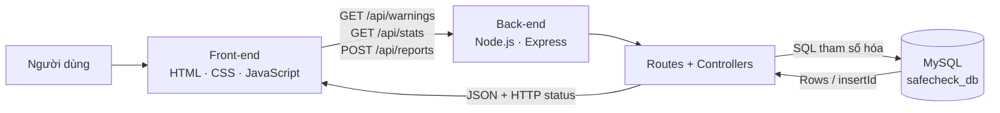
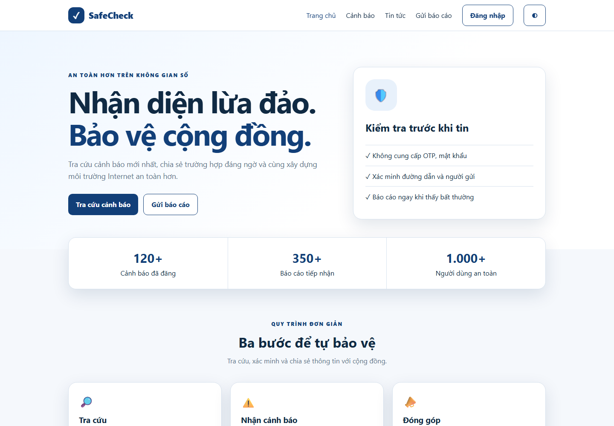
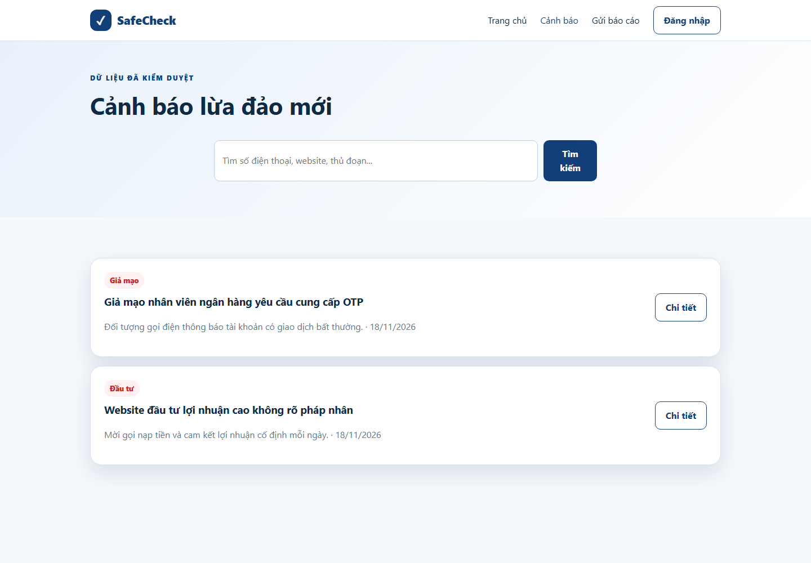
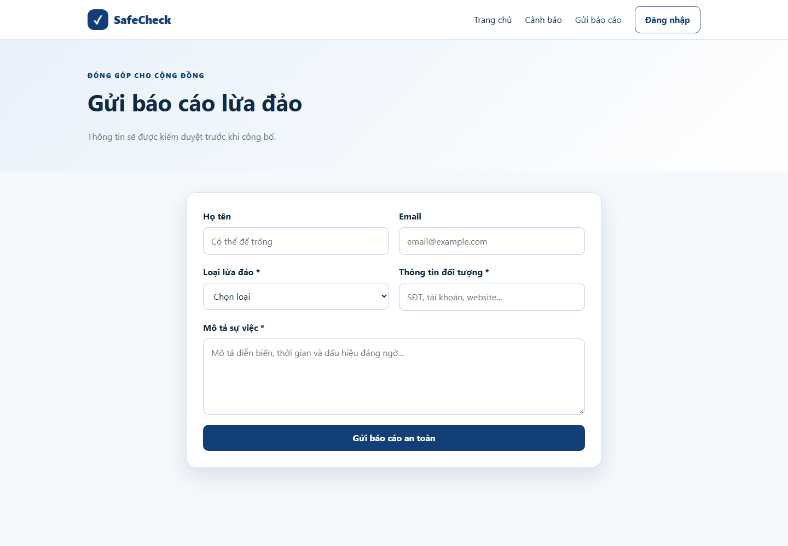
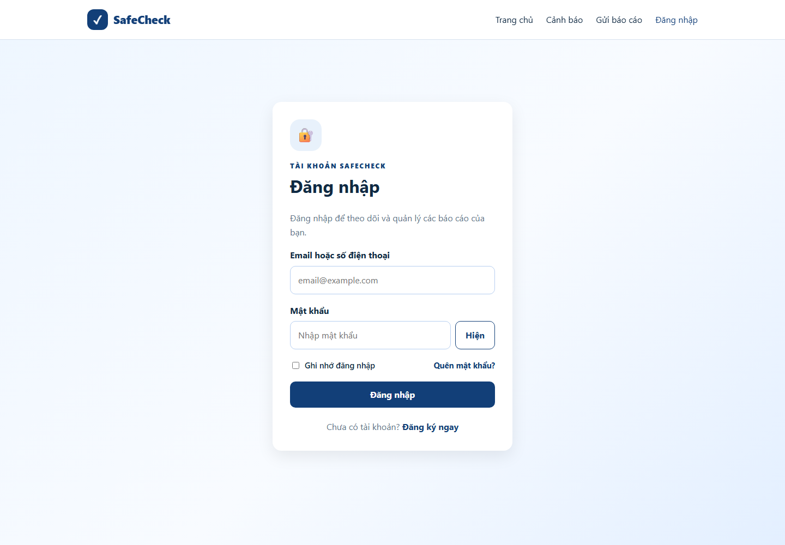
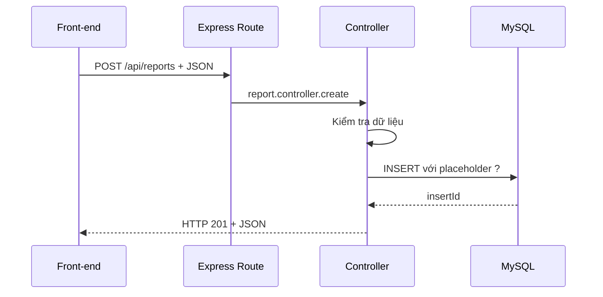
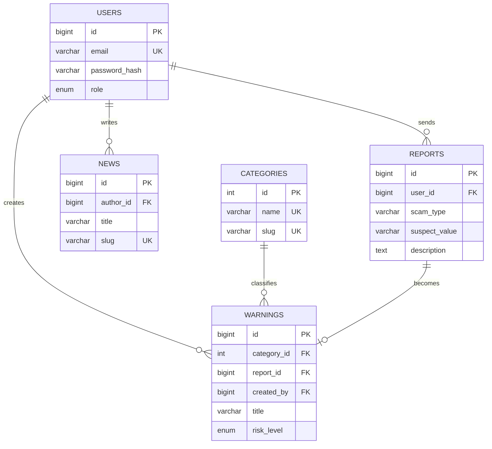

# BÁO CÁO TIẾN ĐỘ WEBSITE SAFECHECK

> Cập nhật 18/11/2026 — giao diện xanh nước biển đậm–trắng; Front-end HTML/CSS/JS; Back-end Node.js/Express; Database MySQL.

## 1. Sơ đồ kiến trúc website



Front-end chỉ hiển thị, nhập liệu và gọi API. Truy vấn DB và nghiệp vụ nằm trong `backend/`; trình duyệt không kết nối trực tiếp MySQL.

## 2. Chức năng hoàn thành và chưa hoàn thành

| Chức năng | Trạng thái | Ghi chú |
|---|---|---|
| Trang chủ xanh–trắng, responsive | Hoàn thành | Số liệu API + dữ liệu dự phòng |
| Danh sách/tìm kiếm cảnh báo | Hoàn thành MVP | GET API |
| Chi tiết cảnh báo | Hoàn thành MVP | GET theo ID |
| Gửi báo cáo | Hoàn thành MVP | Validation hai lớp, lưu MySQL |
| Thống kê tổng quan | Hoàn thành MVP | Đếm reports/warnings/users |
| Dark mode | Hoàn thành cơ bản | Lưu localStorage |
| Đăng ký, đăng nhập, quên mật khẩu | Chưa kết nối | Cần API auth |
| Upload bằng chứng | Chưa hoàn thành | `upload.js` là vị trí giữ chỗ |
| Tin tức/hướng dẫn | Chưa hoàn thành | Có schema, chưa có API |
| Quản trị và phân quyền | Chưa hoàn thành | Cần auth + CRUD |
| Test tự động/triển khai | Chưa hoàn thành | Giai đoạn sau |

## 3. Giao diện các trang chính

Ảnh chụp thật được tạo ngày 18/11/2026. Thiết kế dùng xanh nước biển đậm `#123f78`, nền trắng/xanh nhạt, card bo góc và responsive.

### Trang chủ



### Danh sách cảnh báo



### Gửi báo cáo



### Đăng nhập



## 4. Chức năng đã kết nối Back-end

| Trang | API | Kết quả |
|---|---|---|
| Trang chủ | `GET /api/stats` | Tổng báo cáo/cảnh báo/người dùng |
| Cảnh báo | `GET /api/warnings?q=...` | Danh sách đã công bố |
| Chi tiết | `GET /api/warnings/:id` | Cảnh báo theo ID |
| Gửi báo cáo | `POST /api/reports` | Tạo báo cáo, trả ID |
| Health check | `GET /api/health` | Trạng thái API |

## 5. Cách Front-end gửi dữ liệu

GET dùng để đọc: `SafeCheck.api('/warnings?q=ngan-hang')`. POST JSON dùng để tạo dữ liệu:

```js
await SafeCheck.api('/reports', {
  method: 'POST',
  body: JSON.stringify({ scamType, suspectValue, description })
});
```

`assets/js/main.js` gắn `Content-Type: application/json`, kiểm tra HTTP status và giải mã JSON.

## 6. Back-end xử lý và trả kết quả



Thành công trả `{ success: true, message, data }`; lỗi nhập liệu `422`, không tìm thấy `404`, lỗi server `500`. SQL dùng placeholder `?` để giảm nguy cơ SQL injection.

## 7. Thiết kế cơ sở dữ liệu



Chi tiết trường, index, PK, FK và `ON DELETE` nằm trong `DB/schema.sql`.

## Phân chia JavaScript

```text
assets/js/                  JavaScript dùng chung toàn website
backend/public/js/member*/  DOM, form, fetch API và hiển thị của thành viên 1–4
backend/server.js           Express, middleware, static files
backend/routes/             URL và HTTP method
backend/controllers/        Validation, truy vấn, JSON response
backend/config/database.js  Pool MySQL
backend/middleware/         Xử lý lỗi
DB/                         Schema và seed, không phải JS runtime
```

Theo quy ước của nhóm, JavaScript đã hoàn thành của thành viên 1–4 được tập trung tại `backend/public/js/` và được Express phục vụ như tài nguyên tĩnh. Các file placeholder của thành viên 5–6 vẫn nằm trong thư mục thành viên. Logic truy vấn dữ liệu nằm riêng trong controller Back-end.

## Cài đặt và biến môi trường

1. Cài Node.js 18+ và MySQL 8+.
2. Chạy `DB/schema.sql`, rồi `DB/seed.sql`.
3. Sao chép `backend/.env.example` thành `backend/.env`, sửa thông tin DB.
4. Trong `backend`: chạy `npm install`, sau đó `npm start`.
5. Mở `http://localhost:3000`; không mở bằng `file://`.

Các biến: `DB_HOST`, `DB_PORT`, `DB_USER`, `DB_PASSWORD`, `DB_NAME`, `DB_CONNECTION_LIMIT`, `PORT`, `CLIENT_URL`. `.env` thật bị loại khỏi Git; chỉ commit `.env.example`.

Trước production cần bổ sung Helmet, rate limit, auth JWT/session, kiểm soát upload, log và test.

